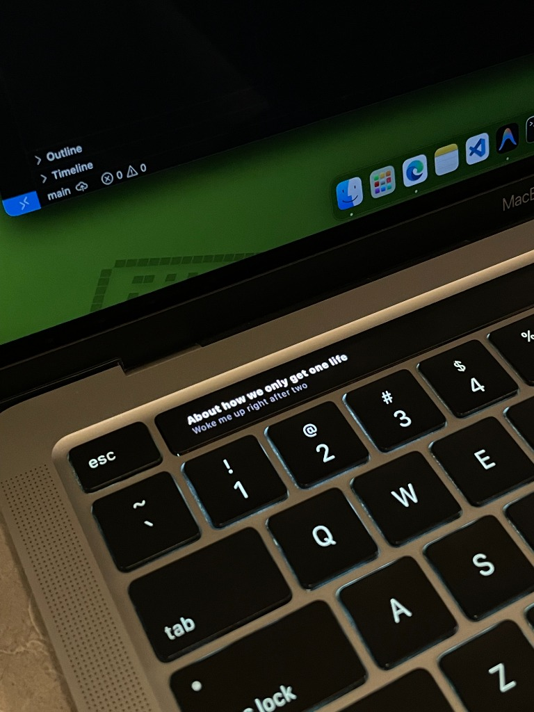
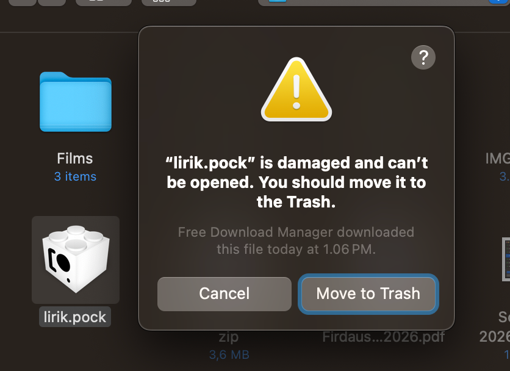
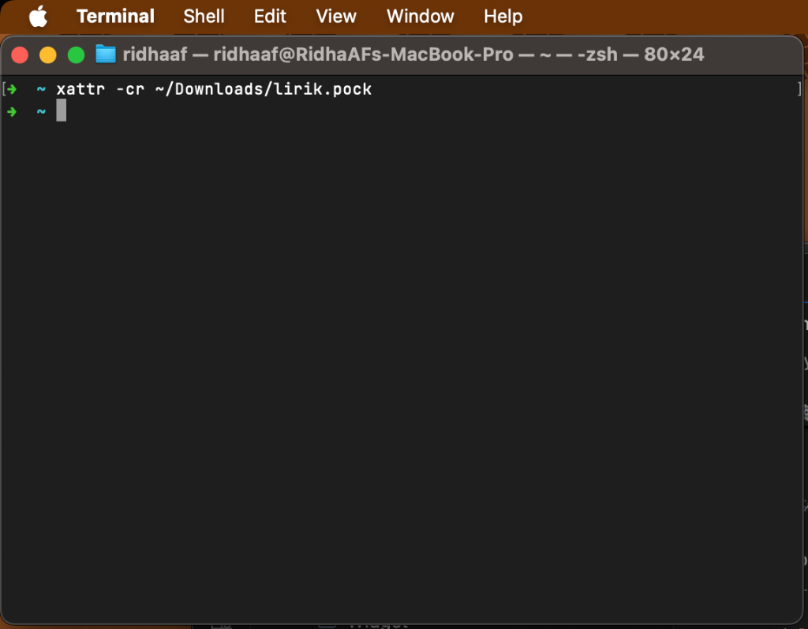
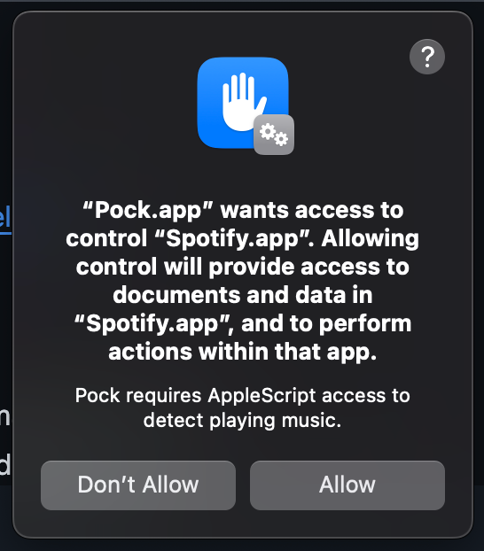

# 🎵 Lirik: Touch Bar Synced Lyrics for macOS (v1.4.2)

**Lirik** is a macOS Touch Bar widget that displays real-time synchronized lyrics for whatever song is playing in **Spotify**, **Apple Music**, **YouTube**, or **YouTube Music** in a browser (Safari, Chrome, Edge, Brave, Vivaldi, Opera, Chromium, Arc, Firefox). Built as a native plugin for **Pock**.



---

## ⚡ Features

- **Real-Time Karaoke Lyrics**: Synchronized line-by-line lyrics powered by LRCLIB API with binary-search sync engine.
- **YouTube Browser Support**: Picks up YouTube music videos playing in Safari, Chrome, Edge, Brave, Vivaldi, Opera, Chromium, Arc, Firefox, Zen, and LibreWolf. Chromium browsers and Safari report the live `<video>` position; Arc and Firefox report the tab title only and fall back to auto-advancing lyrics. See the [browser matrix](#-youtube-browser-setup), and *Conflict behavior* below for what happens when a music app and a browser play at once.
- **YouTube Music Support**: `music.youtube.com` tabs use exact Media Session metadata (title, artist, album) instead of tab-title parsing, plus audible-tab ranking when several browsers play at once.
- **Smart Track Sanitization**: Automatically cleans track titles (strips `(Remastered)`, `[feat.]`, `- Live`) for **30%+ higher lyric match rates**.
- **Tap-to-Copy Touch Bar Gesture**: Tap any active lyric on your Touch Bar to instantly copy the text to your macOS clipboard.
- **Auto-Advancing Plain-Text Fallback**: Progressively steps through static lyrics if time-synced LRC lyrics are unavailable.
- **Album Artwork Thumbnail**: Displays album cover art alongside lyrics on the Touch Bar. YouTube videos show the square-cropped video thumbnail.
- **Song Title & Artist Display**: Shows song title and artist name (with featuring info) when a track changes, karaoke-style.
- **Customizable Preferences**:
  - **Display Mode**: Choose between **2-Line Karaoke** or **1-Line Compact** mode.
  - **Text Alignment**: **Left Aligned** or **Center Aligned**.
  - **Lyric Text Size**: Small, Medium, or Large.
  - **8 Highlight Color Themes**: White, Gold, Cyan, Green, Purple, Pink, Orange, and Red.
  - **Marquee Scrolling Toggle**: Enable/disable smooth horizontal marquee scrolling for long lyric lines.
  - **Music Player Source**: Auto-detect, Spotify Only, Apple Music Only, or Browser Only (YouTube in any supported browser).
  - **Pause Indicator**: Toggle `⏸` icon display when paused.
  - **Album Artwork**: Toggle album artwork thumbnail and choose size (Small, Medium, Large).
  - **Song Title & Artist**: Toggle song title & artist display when track changes.
  - **Clear Cache Button**: Purge local disk cache with one click.
- **Zero Backend**: 100% client-side, lightweight, and fast.

---

## 📥 How to Install

### Prerequisites

1. Ensure you have **Pock** installed on your Mac:
   👉 **Download Pock**: [https://pock.app](https://pock.app)

---

### Step-by-Step Installation Guide

#### 1. Download the Widget
- Download the latest **`lirik.zip`** from [GitHub Releases](https://github.com/RidhaAF/lirik/releases).

#### 2. Clear macOS Quarantine (Crucial)
To prevent macOS Gatekeeper from showing **"lirik.pock is damaged and can't be opened"** or Pock's **`error.invalid-bundle`**:



Run this single command in **Terminal** before opening the widget:
```bash
xattr -cr ~/Downloads/lirik.pock
```



#### 3. Install into Pock
- **Double-click `lirik.pock`** to install automatically in Pock.
- *(Alternative Manual Copy)*: Move `lirik.pock` directly into your Widgets folder:
  ```bash
  cp -R ~/Downloads/lirik.pock ~/Library/Application\ Support/Pock/Widgets/
  ```

#### 4. Enable Lirik on your Touch Bar
1. Click the **Pock** icon in your macOS menu bar.
2. Select **Manage widgets...** (or **Preferences...**).
3. Ensure **Lirik** is enabled (green indicator dot).
4. Click **Customize Pock...** to drag **Lirik** onto your physical Touch Bar layout.

---

### 🔑 First-Time Permission Setup (macOS 15+)

When playing music for the first time:

1. Open **Spotify** or **Apple Music** and start playing a track.
2. macOS will present a system authorization popup:

   

   Click **Allow**.
3. If the popup does not appear or permission was previously denied:
   - Go to **System Settings** $\rightarrow$ **Privacy & Security** $\rightarrow$ **Automation**.
   - Find **Pock** and toggle **Spotify** (and **Music**) to **ON**.
   - Or run this command in **Terminal** to reset system permission prompts, then quit and reopen **Pock** and **Spotify** / **Apple Music**:
      ```bash
      tccutil reset AppleEvents
      ```

### 🌐 YouTube Browser Setup

Lirik reads YouTube tabs through each browser's own scripting interface, so what it can do depends on the browser:

| Browser | Detection | Synced lyrics | Extra permission |
|---|---|---|---|
| **Safari**, **Chrome**, **Edge**, **Brave**, **Vivaldi**, **Opera**, **Chromium** | tab URL + title | ✅ live `<video>` position | Automation + *Allow JavaScript from Apple Events* |
| **Arc** | tab URL + title | ⏸ auto-advancing static lyrics | Automation |
| **Firefox**, **Zen**, **LibreWolf** | tab title only | ⏸ auto-advancing static lyrics | Accessibility + Automation |

1. Play any YouTube music video. macOS prompts once per browser, so click **Allow**. Later: **System Settings** $\rightarrow$ **Privacy & Security** $\rightarrow$ **Automation** $\rightarrow$ **Pock**.
2. **Chromium browsers and Safari**: enable **Allow JavaScript from Apple Events** (**View** $\rightarrow$ **Developer**; in Safari first show the Develop menu via **Safari Settings** $\rightarrow$ **Advanced**). Without it Lirik still reads the title, but the position is estimated instead of measured, so lyrics auto-advance rather than follow the video exactly.
3. **Firefox, Zen, LibreWolf**: enable **Pock** under **System Settings** $\rightarrow$ **Privacy & Security** $\rightarrow$ **Accessibility**. Firefox has no AppleScript tab interface (Mozilla bugs [369901](https://bugzilla.mozilla.org/show_bug.cgi?id=369901) / [939528](https://bugzilla.mozilla.org/show_bug.cgi?id=939528)), so Lirik reads the tab title from the accessibility tree. That means no playback position and no video ID, so Firefox tracks get no closed-caption fallback and no video thumbnail.

### ⚖️ Conflict behavior (Spotify/Music + YouTube at once)

Priority is **Spotify > Apple Music > Browser**. If a music app reports *any* track, even a paused one, its lyrics win over a playing YouTube tab. To force YouTube lyrics while a music app is open, set **Music Player Source** to **Browser Only** in Lirik preferences.

---

## ⚙️ Customizing Preferences

You can customize Lirik's layout, colors, alignment, and font size directly inside Pock:

1. Click the **Pock** icon in your macOS menu bar $\rightarrow$ **Manage widgets...**
2. Select **Lirik** in the left sidebar.
3. Configure your preferred settings:
   - **Display Mode**: Select *2-Line Karaoke* or *1-Line Compact*.
   - **Text Alignment**: Select *Left Aligned* or *Center Aligned*.
   - **Text Size**: Choose *Small*, *Medium*, or *Large*.
   - **Highlight Color**: Choose from 8 themes (*White, Gold, Cyan, Green, Purple, Pink, Orange, Red*).
   - **Marquee Scrolling**: Toggle smooth scrolling for long lines.
   - **Player Source**: Select *Auto-detect*, *Spotify*, *Apple Music*, or *Browser Only* (YouTube).
   - **Timing Offset**: One stepper that nudges lyric timing in 0.25s steps. While a YouTube video plays it edits that video's saved offset; otherwise it edits the global offset applied to every track. Positive shows lyrics earlier.
   - **Pause Indicator**: Toggle `⏸` icon when paused.
   - **Album Artwork**: Toggle album artwork thumbnail and choose size.
   - **Song Title & Artist**: Toggle song title & artist display on track change.
   - **Clear Cache**: One-click button to purge local lyrics cache.

---

## 🛠 Building from Source

```bash
# Clone the repository
git clone https://github.com/RidhaAF/lirik.git
cd lirik

# Install dependencies via CocoaPods
pod install

# Build release bundle
xcodebuild -workspace lirik.xcworkspace -scheme lirik -configuration Release build ENABLE_USER_SCRIPT_SANDBOXING=NO
```

The output bundle `lirik.pock` will be located in `dist/lirik.pock`.

---

## 👥 Contributors

- [@RidhaAF](https://github.com/RidhaAF): Creator & Maintainer
- [@rizkifdh](https://github.com/rizkifdh): Permission fix, album artwork, song title & artist display
- [@yasiramri](https://github.com/yasiramri): Lyrics sync freeze fix (elapsed-time interpolation, wake refresh), macOS 11+ compatibility
- [@vadhh](https://github.com/vadhh): Lyrics timing offset preference, long-line widget fix, AppleScript script-reuse performance

---

## 📄 License

[MIT License](LICENSE) © Ridha Ahmad Firdaus
